<div align="center">



<br />

[](https://theorygambit.github.io/)
[](https://hassanireza.github.io/gambit)
[](#stack)
[](#visual-grammar)
[](#the-iphone-contract)

</div>

<br />

Theory Gambit is a mobile first game for every game theory in [The Gambit](https://hassanireza.github.io/gambit), a field guide to strategy. Each game teaches its theory in three beats: you **feel** it, you **see** it, then you **prove** you understood it on a case you have not met. Black and white, dark and light, installable on the iPhone home screen.

**Play:** [theorygambit.github.io](https://theorygambit.github.io/)
**Field guide:** [The Gambit](https://hassanireza.github.io/gambit), 116 entries in ten chapters. Entry numbers there match the order of the game.

---

## How a game teaches

A game that only shows a theory, or wraps it in a score, has failed. The player must leave able to apply the idea to a case they have not seen. So every game has exactly three beats, in this order, drawn as a progress bar at the top of the canvas.

<div align="center">
  
</div>

| Beat | What happens |
|---|---|
| **Feel** | The player plays first, with no explanation. They collect evidence with their own hands, and where possible see what the other choice would have paid. |
| **See** | The structure behind what they just did is revealed, built from their own moves. They must act to reveal it. Nothing is explained by a wall of text. |
| **Prove** | The idea is applied to a new case with different numbers. A remembered answer cannot pass. A wrong answer shows why, then lets them retry. Only passing Prove marks a theory as understood. |

One game is about 60 to 90 seconds. Prompts are one or two short sentences. There are no tutorials and no menus inside a game.

---

## Where it stands

The app has one slot for each of the 116 topics in The Gambit, plus two synthesis capstones that mix several theories. Slots are ordered easy to hard: Foundations, Core, Advanced, the hypergame finale, then the capstones.

<div align="center">
  
</div>

| Slot | Game | State |
|---|---|---|
| 001 | Dominant Strategy | Live |
| 002 | Prisoner's Dilemma | Live |
| 003 | Matching Pennies | Live |
| 004 | Stag Hunt | Live |
| 005 | Ultimatum Game | Live |
| 006 | What Is a Game? | Live |
| 007 | Rationality and Common Knowledge | Live |
| 008 | Normal Form vs Extensive Form | Live |
| 009 | Zero-Sum Games | Live |
| 010 | Positive-Sum Games | Live |
| 011 | Negative-Sum Games | Live |
| 012 | Simultaneous vs Sequential Games | Live |
| 013 | Single, Two and Multi-Player Games | Live |
| 014 | A Taxonomy of Games | Live |
| 015 | Pareto Efficiency | Live |
| 016 | Focal Points (Schelling Points) | Live |
| 017 | Chicken and Hawk-Dove | Live |
| 018 | Battle of the Sexes | Live |
| 019 | Dictator Game | Live |
| 020 | Trust Game | Live |
| 021 | Tragedy of the Commons | Live |
| 022 | Axelrod's Tournaments and Tit for Tat | Live |
| 023 | Flow Theory | Live |
| 024 | Designing With Care: Ethics of Applied Game Theory | Live |
| 025 | Expected Utility Theory | Live |
| 026 | Perfect, Imperfect, Complete and Incomplete Information | Live |
| 027 | Short vs Long Games | Live |
| 028 | Iterated Elimination | Live |
| 029 | Nash Equilibrium | Live |
| 030 | Mixed Strategy | Live |
| 031 | Minimax Theorem | Live |
| 032 | Backward Induction | Live |
| 033 | Public Goods Game | Live |
| 034 | Centipede Game | Live |
| 035 | Traveler's Dilemma | Live |
| 036 | Volunteer's Dilemma | Live |
| 037 | Keynesian Beauty Contest | Live |
| 038 | Dollar Auction | Live |
| 039 | Colonel Blotto | Live |
| 040 | Cournot Competition | Live |
| 041 | Bertrand Competition | Live |
| 042 | Stackelberg Game | Live |
| 043 | Hotelling's Location Game | Live |
| 044 | Repeated Games | Live |
| 045 | Dynamic Games | Live |
| 046 | Evolutionary Game Theory | Live |
| 047 | Adverse Selection and the Market for Lemons | Live |
| 048 | Auctions | Live |
| 049 | Matching Markets and Stable Matching | Live |
| 050 | Cooperative and Coalitional Games | Live |
| 051 | Prospect Theory | Live |
| 052 | Allais Paradox | Live |
| 053 | Loss Aversion and Streak Systems | Live |
| 054 | Preference Manipulation | Live |
| 055 | Behavioral Game Theory | Live |
| 056 | Reciprocity and Social Norms | Live |
| 057 | Hyperbolic Discounting | Live |
| 058 | Near-Miss Effect | Live |
| 059 | Sunk Cost and the Endowment Effect | Live |
| 060 | Breaking Frames: Changing the Game | Live |
| 061 | Finite and Infinite Games | Live |
| 062 | Choosing Your Game: Game Selection | Live |
| 063 | Commitment and Credible Threats | Live |
| 064 | Multipolar Traps and Coordination Failures | Live |
| 065 | Minimax Search and Alpha-Beta Pruning | Live |
| 066 | Elo, Glicko and TrueSkill Ratings | Live |
| 067 | Dynamic Difficulty Adjustment | Live |
| 068 | Player Lifetime Value Prediction | Live |
| 069 | Rules Engines and Experimentation Systems | Live |
| 070 | The Engagement Stack: How the Layers Combine | Live |
| 071 | Correlated Equilibrium | Live |
| 072 | Subgame Perfect Equilibrium | Live |
| 073 | Trembling Hand Perfect Equilibrium | Live |
| 074 | Sequential Equilibrium | Live |
| 075 | Perfect Bayesian Equilibrium | Live |
| 076 | Price of Anarchy | Live |
| 077 | War of Attrition | Live |
| 078 | Folk Theorem | Live |
| 079 | Markov (Stochastic) Games | Live |
| 080 | Potential Games | Live |
| 081 | Evolutionarily Stable Strategy | Live |
| 082 | Replicator Dynamics | Live |
| 083 | Bayesian Games | Live |
| 084 | Signaling Games | Live |
| 085 | Screening and Principal-Agent Problems | Live |
| 086 | Cheap Talk | Live |
| 087 | Bayesian Persuasion | Live |
| 088 | Mechanism Design | Live |
| 089 | The Revelation Principle | Live |
| 090 | VCG Mechanism | Live |
| 091 | The Core | Live |
| 092 | Shapley Value | Live |
| 093 | Banzhaf and Shapley-Shubik Power Indices | Live |
| 094 | The Nucleolus | Live |
| 095 | Nash Bargaining | Live |
| 096 | Rubinstein Alternating-Offers Bargaining | Live |
| 097 | Ellsberg Paradox and Ambiguity Aversion | Live |
| 098 | Level-k and Cognitive Hierarchy | Live |
| 099 | Quantal Response Equilibrium | Live |
| 100 | Inequity Aversion (Fehr-Schmidt) | Live |
| 101 | Spiteful Preferences | Live |
| 102 | Zermelo's Theorem and Combinatorial Games (Nim) | Live |
| 103 | Monte Carlo Tree Search | Live |
| 104 | Regret Matching and Counterfactual Regret Minimization | Live |
| 105 | Fictitious Play | Live |
| 106 | Computing Nash Equilibria: Lemke-Howson and PPAD | Live |
| 107 | Linear Programming for Zero-Sum Games | Live |
| 108 | Multiplicative Weights and Hedge | Live |
| 109 | Multi-Agent Reinforcement Learning and Self-Play | Live |
| 110 | Contextual Bandits | Live |
| 111 | Personalized and Dynamic Pricing | Live |
| 112 | Context-Aware and On-Device Recommendation | Live |
| 113 | Desirability Scoring (RSRR) | Live |
| 114 | Hypergame Theory | Live |
| 115 | The Levels of Hypergames | Live |
| 116 | Metagames and the Metagame Theory | Live |
| 117 | Frames Within Frames | Live |
| 118 | The Whole Board | Live |

Link straight to one topic with `https://theorygambit.github.io/g/<slug>`, for example `/g/stag-hunt`. There is no hash in the address. Older `/#/g/<slug>` links still work and are upgraded in place. A topic with no game yet opens its empty slot, so links are safe to add before every game exists.

---

## Visual grammar

Every game speaks the same small language, so a new game is readable before it is explained.

<div align="center">
  
</div>

- **You are the filled disc. The other player is the ring.**
- **A payoff is the area of a disc**, not its radius. Numbers sit small in the corner.
- Hairlines are exactly one device pixel. Corners are square.
- Motion is critically damped: nothing bounces, nothing snaps. Reveals fade or grow, they never slide text.
- One soft light from above and a coarse grain on the ground. Nothing else is decorative.

---

## Art direction

The brand is Abyssal Liturgy from [hassanireza.github.io](https://hassanireza.github.io/branding), in black and white and followed to the letter. Dark is the brand. Light is its exact inverse.

<div align="center">
  
</div>

| Token | Dark | Light |
|---|---|---|
| Ground | Void `#08090b` | Bone `#e6e3da` |
| Ink | Bone `#e6e3da` | Void `#08090b` |
| Fog, secondary | `#9aa3a8` | `#363e43` |
| Ash, tertiary | `#7f8589` | `#4c555b` |

Every text pair is at least 4.5 to 1. Colours live in `src/styles/tokens.css` and games read them through `Palette`, never hard coded.

Type is **Cormorant Garamond** italic 300 for titles, prompts and takeaways, **Jost** 300 and 400 for labels and body, and **JetBrains Mono** 400 for numbers and formulas. Only those weights are loaded, and `font-synthesis: none` stops the browser faking a bold.

---

## Stack

- **React 19** with **TypeScript 6**, strict. React is only the shell around the game.
- **Vite 8** for development and the production build.
- Games and engines are **classes**: a pure model, a game class, and an engine of small parts. No runtime dependency besides React.
- **Canvas 2D** for every game, 1:1 with device pixels, text drawn inside the canvas.
- **WebGL2** for a decorative background network. It never decides who is right.
- **oxlint** for linting, **tsx** for model tests, **Playwright** for the iPhone and layout checks.
- Plain CSS with one token file. No CSS in JS, no utility framework, no state library.

---

## Architecture

<div align="center">
  
</div>

React never reaches into a game. `GameScreen` creates a `GameRuntime`, which asks the registry for the game. The game talks upward only through a typed event bus (`beat`, `announce`, `complete`). Logic lives in pure models, each with a test proving the model matches the theory, so rendering never decides who is right.

```
src/
  core/      engine classes, no React
  catalog/   entries (generated from The Gambit), curriculum (order and tiers)
  games/     one folder per game: model, game class, module
  td/        WebGL2 decorative background
  theory/    the TheoryEntry type
  ui/        React shell
  styles/    tokens.css, the single source of colour
tools/       model tests, iPhone check, layout check, catalog sync, icons
docs/        read FOUNDATION first
```

To add a game, write its module and register it. Order in the app comes only from `src/catalog/curriculum.ts`. The steps are in `docs/ADDING_A_GAME.md`.

---

## The iPhone contract

A home screen app launches in a different window than Safari, and two bugs follow if it is ignored: an empty strip at the bottom, and soft text. Both are fixed by construction.

- **Size.** The root is never sized with `100vh` or `100dvh`. `Viewport.ts` measures the real window and sets `--app-h`.
- **Blur.** No text sits in an animated layer. Text over a canvas is drawn in the canvas at whole pixels.
- **Touch.** Zoom and gestures are blocked, and only the first pointer steers.
- **Icon.** The home screen icon is an opaque 180 pixel PNG served from the site root, `apple-touch-icon.png`, where iOS looks first.

`npm run verify:iphone` proves the contract with numbers, not screenshots. **After deploying, delete the home screen icon and add the app again.** iOS keeps the old icon, meta tags and layout until you do.

---

## Layout that never collides

Text overlapping text, and labels sitting on shapes, was a real bug on short phone screens. It is now prevented by structure and proved by a check.

- **A frame.** Every game gets its prompt, body, note, action row and tick row from `Game.frame`, computed from the real canvas height. A game draws its figure only inside the body, so nothing can run into the prompt, the note or the buttons.
- **An auditor.** In audit mode the painter records every text box, disc, ring and line. `npm run verify:layout` opens every game at seven screen sizes, drives it through every beat and the states between, and fails on any overlap, any text leaving the canvas, or any prompt or note longer than two lines.

The rules for drawing a figure are in `docs/LAYOUT.md`. Read them before writing a game.

---

## Deploy and quality gates

Deploy by pushing to `main`. The workflow runs the gates in order, and only when every one passes does it publish.

<div align="center">
  
</div>

One time setup: create the repository **theorygambit.github.io**, push to `main`, then set **Settings, Pages, Source** to **GitHub Actions**. Run `npm install` once and commit `package-lock.json`. See `docs/DEPLOY.md`.

---

## Run

```
npm install
npm run dev              # development
npm test                 # model tests
npm run typecheck
npm run lint
npm run build && npm run preview
npm run verify:iphone    # needs: npx playwright install chromium
npm run verify:layout    # every game, seven screen sizes, no overlaps
```

Open the app with `?debug=1` to reach the running game on `window.__tg.game`, for example `__tg.game.debugGoto("prove")`.

---

## Docs

Read `docs/FOUNDATION.md` before changing anything. If a new game breaks one of its rules, the game is wrong, not the rule.

| File | What it holds |
|---|---|
| `FOUNDATION` | The five principles, the visual grammar, the hard technical rules |
| `ARCHITECTURE` | The layers, the data flow, the curriculum |
| `ART_DIRECTION` | Colour, type, shape and motion |
| `ADDING_A_GAME` | The steps from paper design to a registered game |
| `LAYOUT` | The frame, spacing rules and the overlap auditor. Read before drawing anything |
| `FEEDBACK` | Sound and haptics on iPhone: what Safari allows and how it is wired |
| `IPHONE_CONTRACT` | The size, blur and touch rules, and how they are checked |
| `DEPLOY` | One time setup, releases, and adding the app to a phone |
| `GAMBIT_HIGHLIGHT` | How the game is shown on The Gambit page |
| `NEXT` | What shipped, and notes for adding a game |
